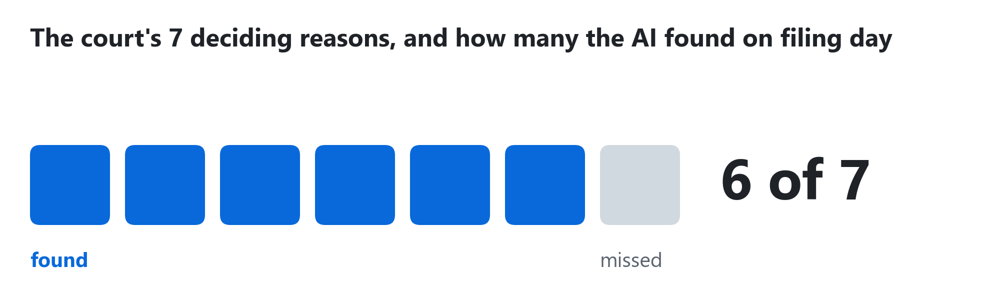
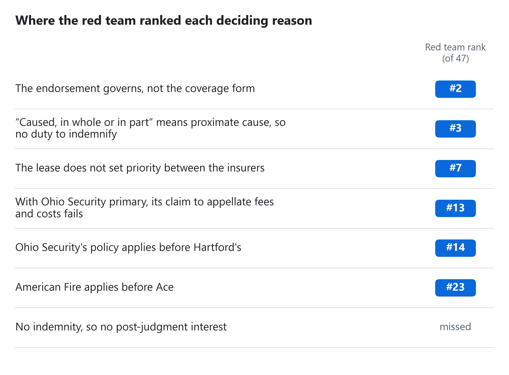
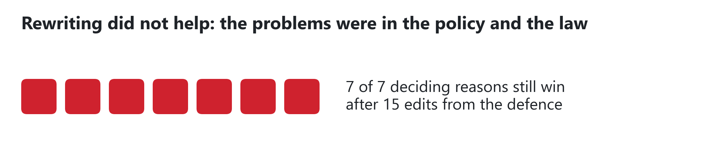
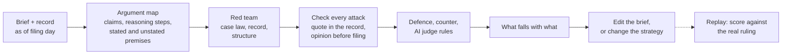

# Killing Cases

*Kill your own case before the other side does.*

**Given only what the lawyers had on filing day, an AI red team found the flaw that sank their motion.**

We took a real summary-judgment brief from a federal insurance case (*Hartford v. Carson Madrona*, N.D. Cal.), turned it into a map of its argument, and let AI agents attack it using only the papers filed by that day. Then we checked the attacks against the court's actual ruling, 77 days later.

<picture>
  <source media="(prefers-color-scheme: dark)" srcset="docs/figures/scoreboard-dark.png">
  
</picture>

**It ranked the court's first two reasons #2 and #3 of 47 attacks, and backed every attack with a quote from the filings or a real court opinion.**

## What we found

### The fatal flaw was never written down

<picture>
  <source media="(prefers-color-scheme: dark)" srcset="docs/figures/seams-dark.png">
  
</picture>

The brief silently assumed that a no-fault clause in the policy governed. The red team's #2 attack went straight at that assumption, and the court's first ruling was that a fault-based endorsement governed instead. Across the brief, attacks on unstated assumptions were far more likely to survive the defence.

### Every deciding reason, and where it ranked

<picture>
  <source media="(prefers-color-scheme: dark)" srcset="docs/figures/scorecard-dark.png">
  
</picture>

Every rank was fixed on filing day, before the other side filed its opposition.

### Rewriting could not save it

<picture>
  <source media="(prefers-color-scheme: dark)" srcset="docs/figures/rewritten-dark.png">
  
</picture>

The AI defence fixed real errors in the brief, such as a misstated judgment amount and misdated letters. The court's reasons still won, because the problems were in the policy and the law, not the prose. The answer the tool gives here: change the strategy, not the wording.

## What this means

Attack the assumptions a brief never states, before the other side does. An argument map shows which assumptions carry the case, proves each attack from the record, and tells you whether to edit the brief or change the strategy.

<sub>Research proof of concept · 1 replayed case so far · [How we tested →](docs/results.md)</sub>

---

## The thesis

Our bet: most cases have a kill shot, and it is often an assumption nobody wrote down. You cannot map a legal argument perfectly: even trained legal annotators needed several rounds of revised guidelines to agree on how court arguments are structured ([Habernal et al.](https://arxiv.org/abs/2208.06178)). But you can grow a good-enough map by trying to kill the case, the way security teams attack their own software.

| Security testing | Killing Cases |
| --- | --- |
| The program | The brief |
| An undocumented assumption | A premise the brief relies on but never states |
| An exploit | A kill shot: an attack proved from the record or real case law |
| The blast radius | Every claim that dies with that premise |

What we want to show next:

1. **Seams.** Across many briefs, unstated assumptions carry far more than their share of the attacks that win.
2. **Blast radius.** Computing which claims fall with a premise can match the court claim by claim. It matched 9 of 14 here; formal argumentation semantics should do better.
3. **Convergence.** Each round of attack and repair makes two independent maps of the same brief agree more.
4. **Debate.** A judge that hears attack, defence and counter rules closer to the real court than one that reads the attacks alone ([Khan et al.](https://arxiv.org/abs/2402.06782) found this for factual questions).

## How it works



A large language model writes the map, the attacks, the answers and the rulings. A small decision model makes hundreds of yes/no checks, such as "does this passage support this premise?". Plain code locates quotes, looks up case law on [CourtListener](https://www.courtlistener.com/), and computes which claims fall.

## The replayed case

*Hartford Fire v. Carson Madrona*, N.D. Cal. No. 23-cv-06259-VC. Two insurers moved for partial summary judgment on 2 January 2025; the court denied their motion on 20 March 2025. The AI saw only the brief and the 18 record files filed by that day, and searched only opinions decided before it. Two more public cases are in the test set and not yet replayed.

Watch the [84-second replay](docs/media/replay.mp4), or open the interactive versions in `viewer/`.

## Try it

```powershell
copy .env.example .env      # add the API keys
npm install --include=dev
npm test
npm run run -- hartford-v-carson-madrona
npm run viewer              # http://localhost:4317
python scripts/export_results.py
python scripts/figures.py   # redraws the charts above
```

| Folder | What is in it |
| --- | --- |
| `src/` | The pipeline: map building, checks, attacks, status, replay scoring |
| `viewer/` | Interactive viewer, animated argument graph, replay film |
| `matters/` | The 3 public test cases: filings as text, with what was known on filing day |
| `results/` | The numbers behind every chart |
| `docs/` | [Evidence and method](docs/results.md), [design](docs/design.md) |
