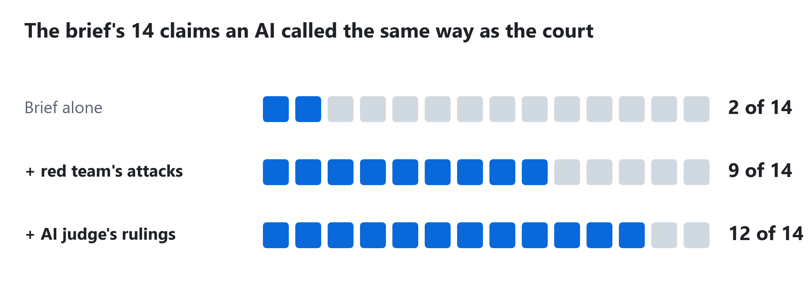
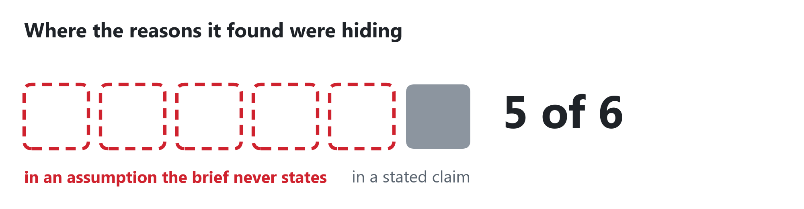
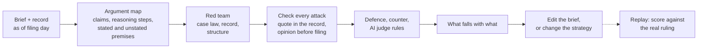

# Killing Cases

*Kill your own case before the other side does.*

**Working only from the papers filed 77 days before the ruling, an AI found 6 of the 7 reasons that decided the motion.**

We took a real summary-judgment brief from a federal insurance case (*Hartford v. Carson Madrona*, N.D. Cal.), turned it into a map of its argument, and let AI agents attack it using only the papers filed by that day. Then we checked the attacks against the court's order. **[Watch the run →](https://killing-cases.vercel.app)**

<picture>
  <source media="(prefers-color-scheme: dark)" srcset="docs/figures/scoreboard-dark.png">
  
</picture>

**The court's first reason was the top pick of two of the three AI attackers. Every quote in an attack is in the filings, and every case it cites was decided before filing day.**

## What we found

### Without the red team, the AI believed the brief

<picture>
  <source media="(prefers-color-scheme: dark)" srcset="docs/figures/readers-dark.png">
  
</picture>

A frontier model called each of the brief's 14 claims, then we compared its calls with the court's order. Reading the brief alone, it rated 6 claims safe that the court did not accept, including the no-fault theory the court rejected first. The red team's attacks are what changed its answer.

### The weak spot was an assumption the brief never wrote

<picture>
  <source media="(prefers-color-scheme: dark)" srcset="docs/figures/seams-dark.png">
  
</picture>

The brief silently assumed that a no-fault clause in the policy governed. The court's first ruling was that a fault-based endorsement governed instead, and the red team attacked that assumption using only the filing-day papers.

### The brief quoted the policy, and skipped the sentence the court relied on

| The policy says | The brief quotes (ECF page 10) |
| --- | --- |
| "…subsequent to the execution of the contract or agreement. … **However, no such person or organization is an insured under this provision if such person or organization is included as an insured by an endorsement issued by us** …" | "…subsequent to the execution of the contract or agreement. **\*\*\*** (c) Lessors of Land or Premises…" |

The record attacker's first attack named the missing sentence. The court's first reason rests on it: the endorsement governs, not the coverage form. Hartford had already cited that endorsement when it withdrew its defence, in a letter filed as Exhibit 11 to the brief.

### Every deciding reason, and where it sat in the red team's list

<picture>
  <source media="(prefers-color-scheme: dark)" srcset="docs/figures/scorecard-dark.png">
  
</picture>

The list was built from filing-day papers only. The other side's opposition and the court's order were held out until scoring.

### Editing the brief did not answer the court

<picture>
  <source media="(prefers-color-scheme: dark)" srcset="docs/figures/rewritten-dark.png">
  
</picture>

The AI's edits fixed real errors in the brief, such as a misstated judgment amount and misdated letters. An AI judge then replayed the court's 7 reasons against the edited brief, and all 7 still beat it: no edit can change the policy wording the court relied on. The answer here is to change the strategy, not the wording.

## What this means

Attack the assumptions a brief never states, before the other side does. An argument map shows which assumptions carry the case, proves each attack from the record, and tells you whether to edit the brief or change the strategy.

<sub>Research proof of concept · 1 replayed case so far · [How we tested →](docs/results.md)</sub>

---

## The thesis

Our bet: most cases have a kill shot, and it is often an assumption nobody wrote down. You cannot map a legal argument perfectly: even trained legal annotators needed several rounds of revised guidelines to agree on how court arguments are structured ([Habernal et al.](https://arxiv.org/abs/2208.06178)). But you can grow a good-enough map by trying to kill the case, the way security teams attack their own software.

| Security testing | Killing Cases |
| --- | --- |
| The program | The brief |
| An undocumented assumption | A premise the brief relies on but never states |
| An exploit | A kill shot: an attack proved from the record or real case law |
| The blast radius | Every claim that dies with that premise |

What we want to show next:

1. **Seams.** Across many briefs, unstated assumptions carry far more than their share of the attacks that win.
2. **Blast radius.** Computing which claims fall with a premise can match the court claim by claim. It matched 11 of 14 here; formal argumentation semantics should do better.
3. **Convergence.** Each round of attack and repair makes two independent maps of the same brief agree more.
4. **Debate.** A judge that hears attack, defence and counter rules closer to the real court than one that reads the attacks alone ([Khan et al.](https://arxiv.org/abs/2402.06782) found this for factual questions).

## How it works



A large language model writes the map, the attacks, the answers and the rulings. A small decision model makes hundreds of yes/no checks, such as "does this passage support this premise?". Plain code locates quotes, looks up case law on [CourtListener](https://www.courtlistener.com/), and computes which claims fall.

## The replayed case

*Hartford Fire v. Carson Madrona*, N.D. Cal. No. 23-cv-06259-VC. Two insurers moved for partial summary judgment on 2 January 2025; the court denied their motion on 20 March 2025. The AI saw only the brief and the 18 record files filed by that day, and searched only opinions decided before it. Two more public cases are in the test set and not yet replayed.

See it at [killing-cases.vercel.app](https://killing-cases.vercel.app), or watch the [84-second replay video](docs/media/replay.mp4).

## Try it

```powershell
copy .env.example .env      # add the API keys
npm install --include=dev
npm test
npm run run -- hartford-v-carson-madrona
npm run viewer              # the site at http://localhost:4317
npx tsx scripts/export_site.ts   # writes it as static files to site/
python scripts/export_results.py
python scripts/figures.py   # redraws the charts above
```

| Folder | What is in it |
| --- | --- |
| `src/` | The pipeline: map building, checks, attacks, status, replay scoring |
| `viewer/` | The site: summary page, the interactive run, the full map |
| `matters/` | The 3 public test cases: filings as text, with what was known on filing day |
| `results/` | The numbers behind every chart |
| `docs/` | [Evidence and method](docs/results.md), [design](docs/design.md) |
